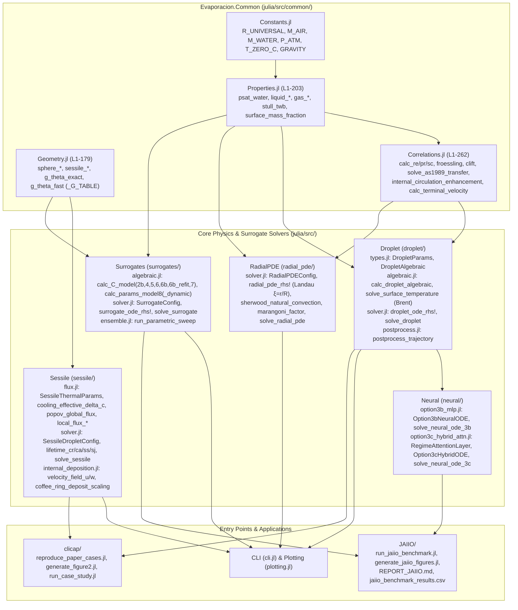

# Evaporacion.jl Knowledge Graph & Architecture Map

> **Purpose**: Low-token high-density reference map of `Evaporacion.jl` and its mapping to literature. Designed to allow AI agents and developers to pinpoint modules, functions, and mathematical models in under 1.5k tokens without scanning hundreds of source or paper files.

---

## 1. System Architecture & Call Graph

---

## 2. Symbol-to-File Index (Line-Level Locator)

Use this table to target `read_file` line ranges directly:

| Submodule | File | Key Functions / Structs | Line Range |
| :--- | :--- | :--- | :---: |
| `Common.Constants` | [`julia/src/common/constants.jl`](file:///d:/programacion/evaporacion/julia/src/common/constants.jl) | `R_UNIVERSAL`, `M_AIR`, `M_WATER`, `P_ATM`, `T_ZERO_C`, `GRAVITY` | `L1–L35` |
| `Common.Properties` | [`julia/src/common/properties.jl`](file:///d:/programacion/evaporacion/julia/src/common/properties.jl) | `psat_water`, `liquid_density_water`, `latent_heat_water`, `gas_diffusivity_water_air`, `stull_twb` | `L1–L203` |
| `Common.Geometry` | [`julia/src/common/geometry.jl`](file:///d:/programacion/evaporacion/julia/src/common/geometry.jl) | `sphere_*`, `sessile_volume_from_r`, `g_theta_exact`, `g_theta_fast`, `g_theta_hu_larson` | `L1–L179` |
| `Common.Correlations` | [`julia/src/common/correlations.jl`](file:///d:/programacion/evaporacion/julia/src/common/correlations.jl) | `calc_re/pr/sc`, `nusselt_froessling`, `clift_correlation`, `blowing_factor`, `solve_as1989_transfer`, `internal_circulation_enhancement`, `calc_terminal_velocity` | `L1–L262` |
| `Droplet` | [`julia/src/droplet/types.jl`](file:///d:/programacion/evaporacion/julia/src/droplet/types.jl) | `DropletParams` (`:d2_classic`, `:d2_stefan`, `:d2_convective`, `:abramzon_sirignano`), `DropletAlgebraic` | `L1–L68` |
| `Droplet` | [`julia/src/droplet/algebraic.jl`](file:///d:/programacion/evaporacion/julia/src/droplet/algebraic.jl) | `calc_droplet_algebraic`, `surface_energy_residual`, `solve_surface_temperature` (Brent) | `L1–L258` |
| `Droplet` | [`julia/src/droplet/solver.jl`](file:///d:/programacion/evaporacion/julia/src/droplet/solver.jl) | `droplet_ode_rhs!`, `solve_droplet` (OrdinaryDiffEq integration) | `L1–L72` |
| `Sessile` | [`julia/src/sessile/flux.jl`](file:///d:/programacion/evaporacion/julia/src/sessile/flux.jl) | `SessileThermalParams`, `cooling_effective_delta_c`, `popov_global_flux`, `local_flux_*` | `L1–L112` |
| `Sessile` | [`julia/src/sessile/solver.jl`](file:///d:/programacion/evaporacion/julia/src/sessile/solver.jl) | `SessileDropletConfig`, `lifetime_cr/ca/ss/sj`, `solve_sessile` | `L1–L249` |
| `Sessile` | [`julia/src/sessile/internal_deposition.jl`](file:///d:/programacion/evaporacion/julia/src/sessile/internal_deposition.jl) | `depth_averaged_radial_velocity`, `velocity_field_u/w`, `coffee_ring_deposit_scaling` | `L1–L89` |
| `RadialPDE` | [`julia/src/radial_pde/solver.jl`](file:///d:/programacion/evaporacion/julia/src/radial_pde/solver.jl) | `RadialPDEConfig`, `radial_pde_rhs!` (Landau immobilized grid), `solve_radial_pde` | `L1–L224` |
| `Surrogates` | [`julia/src/surrogates/algebraic.jl`](file:///d:/programacion/evaporacion/julia/src/surrogates/algebraic.jl) | `calc_C_model(2b,4,5,6,6b,6b_refit,7)`, `calc_params_model8(_dynamic)` | `L1–L196` |
| `Surrogates` | [`julia/src/surrogates/solver.jl`](file:///d:/programacion/evaporacion/julia/src/surrogates/solver.jl) | `SurrogateConfig`, `surrogate_ode_rhs!`, `solve_surrogate` | `L1–L99` |
| `Neural` | [`julia/src/neural/option3b_mlp.jl`](file:///d:/programacion/evaporacion/julia/src/neural/option3b_mlp.jl) | `Option3bNeuralODE`, `solve_neural_ode_3b` | `L1–L84` |
| `Neural` | [`julia/src/neural/option3c_hybrid_attn.jl`](file:///d:/programacion/evaporacion/julia/src/neural/option3c_hybrid_attn.jl) | `RegimeAttentionLayer`, `Option3cHybridODE`, `solve_neural_ode_3c` | `L1–L156` |

---

## 3. Topical Literature Router (60 Papers Map)

| Category / Topic | Target `Evaporacion.jl` Module | Key Papers in [`papers/`](file:///d:/programacion/evaporacion/papers) |
| :--- | :--- | :--- |
| **Classical & Convective $D^2$-Law** | `Droplet` (`:d2_classic`, `:d2_convective`) | Langmuir (1918), Godsave (1953), Kinzer (1951), DallaBarba (2021) |
| **Film Theory & Stefan Flow** | `Droplet` (`:d2_stefan`, `:abramzon_sirignano`) | Spalding (1953), Abramzon & Sirignano (1989), Sirignano (2010), Akkus (2020) |
| **Internal Temperature Profiles** | `Droplet` (`:parabolico`, `:cubico`), `RadialPDE` | Sazhin (2006, 2017, 2021), Zhou et al. (2017) |
| **Sessile Droplet Wetting Modes** | `Sessile` (`:CR`, `:CA`, `:SS`, `:SJ`) | Picknett & Bexon (1977), Dunn et al. (2008), Stauber (2015), Wilson & D'Ambrosio (2023) |
| **Sessile Internal Flow & Coffee Ring** | `Sessile` (`internal_deposition.jl`) | Deegan et al. (1997), Gelderblom et al. (2022), O'Brien (2018), Larson (2014) |
| **Spray Drift & Agricultural Drops** | `clicap/`, `Droplet` (terminal vel.) | Holterman (2003), Renaudo et al. (2022, 2023, 2024, 2025) |
| **Multicomponent Evaporation** | *Missing (see Checklist)* | Tonini & Cossali (2015), Yao (2005), Longest (2005), Ordoubadi (2019) |
| **Marangoni & Convective Instability** | `RadialPDE` (`with_marangoni=true`) | Niazmand (1994), Rocha et al. (2024), Dekker et al. (2025) |
| **Kinetic Non-Equilibrium (Knudsen)** | *Missing (see Checklist)* | Vlasov (2021), Zhao & Nadal (2023) |
| **Experimental Benchmarks** | *Validation reference* | Cioulachtjian (2010), Xu (2011), Devlin (2015), Misyura (2017), Moon (2021), Radmilovic-Radjenovic (2021), Liu (2023), Sun (2025) |
